# Referencias de cada circuito (CR1)

Tarea CR1 del Sprint 10.5 (contrato acordado el 07/11/2026). Para cada uno de los 23 circuitos: el trazado real encajado
sobre el del juego, lo que hay dentro y alrededor de la pista y la lista de lo que hoy no cuadra con la realidad, con su
prioridad y la tarea que lo corregirá (CR2: trazado y pit lane; CR5: edificios emblemáticos de Shanghái y Yas Marina;
CR6: el resto de cada circuito). Lo pinta cada imagen de `docs/design/cr1/`: en negro, el trazado del juego (discontinuo,
su pit lane); en rojo, el real; en azul discontinuo, el agua que pinta el juego; y de OpenStreetMap, bosque (verde),
edificios (gris), agua (azul), gradas (naranja), edificio de boxes (morado), túneles (negro discontinuo) y puentes (rojo).

## Fuentes y licencias

- **Trazado real:** GeoJSON de [bacinger/f1-circuits](https://github.com/bacinger/f1-circuits), licencia MIT (el mismo
  archivo que se bajó en CR8).
- **Alrededores:** © OpenStreetMap contributors, licencia ODbL, por la API pública de Overpass (una consulta por circuito el
  07/11/2026). La consulta pide el rectángulo del circuito más 300 m, porque con la línea entera del trazado el servidor
  público fallaba o devolvía vacío; después se recorta en local a la franja de 300 m alrededor de la pista.
- No se usa nada de Google ni de modelos de pago.
- Los datos en bruto de OpenStreetMap se quedan en `scratch/cr1/` (no van al repositorio). Lo que se guarda en
  `docs/design/cr1/<id>.json` son las huellas ya pasadas a coordenadas del juego, recortadas y simplificadas a 1 m, con el
  identificador de OpenStreetMap de cada una.

## Cómo se mide

1. El trazado real se remuestrea cada 10 m y se encaja sobre el del juego con giro, escala, espejo y traslación (el mismo
   encaje de CK5). La desviación es la distancia de cada punto del trazado del juego al real.
2. Los tramos que se apartan más de 15 m se listan por su punto de la vuelta (fracción desde la meta del juego).
3. El pit lane del juego (su carril rápido) se compara con las vías `highway=raceway` marcadas como pit lane en
   OpenStreetMap, y con el tramo bajo la pista que va marcado como túnel «Pit Lane» (Yas Marina; añadido en CR2).
4. Lo de alrededor se clasifica en árboles, edificios, agua, túneles, puentes, gradas, edificio de boxes y pit lane. Los
   túneles y puentes solo cuentan si cruzan la pista (no alcantarillas ni metro). El edificio de boxes es el edificio largo
   más pegado al pit lane real y de su mismo lado (lo del lado se añadió en CR2).
5. Lo que no cuadra sale de comparar con el escenario del juego (`sceneryFor` y el kit de CK3): agua real que el juego no
   pinta o al revés, objetos del juego sobre agua real, túneles, puentes, edificios, árboles y gradas que faltan, y el lado
   del edificio de boxes. A eso se suman los edificios emblemáticos de CR5.

**Límites:** OpenStreetMap no está igual de completo en todas partes (en Shanghái y Yeda casi no hay árboles ni edificios
mapeados, y Bakú o Interlagos tienen la ciudad entera). Las cifras de edificios y árboles sirven para ver dónde falta
ambiente, no para copiarlas una a una. **Revisado en CR2 (07/11/2026):** la primera versión de este documento daba como de prioridad alta el pit lane de Yas
Marina (55 m, fallo de medida por el tramo en túnel), el edificio de boxes al otro lado en Suzuka y Baréin (se había
tomado una grada de enfrente), las vallas del pit lane de Shanghái (ya no están) y La Source y la horquilla de Suzuka
(abiertas en CR2). Las cifras de Spa, Suzuka y Bakú son las del trazado corregido en CR2. Detalle en
`docs/design/trazado-cr2.md`.

## Resumen

Los trazados del juego salen de los reales y casi coinciden: entre 0,7 y 4,2 m de media. Solo Spa y Bakú tienen algún
tramo que se aparta más de 15 m. Lo que más falta es el entorno: agua que el juego no pinta (Montreal, Melbourne, Marina
Bay, Miami, Las Vegas), objetos puestos sobre agua real, pasos bajo la pista y puentes, y edificios a pie de pista.

En total, 2 puntos de prioridad alta, 58 de media y 34 de baja; 0 para CR2, 2 para CR5 y 92 para CR6.

| Circuito | real (m) | juego (m) | media (m) | máxima (m) | tramos > 15 m | pit lane |
|---|---|---|---|---|---|---|
| `barcelona` | 4664 | 4657 | 0.7 | 3.5 | 0 | 0.5 m de media, 3 m de máxima |
| `monza` | 5787 | 5793 | 1.4 | 6.7 | 0 | 1.6 m de media, 4.8 m de máxima |
| `silverstone` | 5877 | 5891 | 2 | 8.8 | 0 | 1.1 m de media, 5 m de máxima |
| `spa` | 6978 | 7004 | 3.7 | 13.7 | 0 | 1.5 m de media, 9.3 m de máxima |
| `monaco` | 3324 | 3337 | 1.9 | 10.6 | 0 | sin marcar en OpenStreetMap |
| `spielberg` | 4302 | 4318 | 0.8 | 2.6 | 0 | sin marcar en OpenStreetMap |
| `interlagos` | 4298 | 4309 | 2.6 | 9.5 | 0 | 4.8 m de media, 8.2 m de máxima |
| `suzuka` | 5812 | 5807 | 2.3 | 13.3 | 0 | 1.4 m de media, 7.3 m de máxima |
| `zandvoort` | 4255 | 4259 | 1.4 | 12.2 | 0 | 2 m de media, 4.7 m de máxima |
| `las-vegas` | 6221 | 6201 | 1.8 | 7.8 | 0 | 3.9 m de media, 14.7 m de máxima |
| `bahrain` | 5418 | 5412 | 0.8 | 6.3 | 0 | 2.9 m de media, 7.1 m de máxima |
| `baku` | 5986 | 6003 | 1.9 | 11.8 | 0 | 3.8 m de media, 8.3 m de máxima |
| `melbourne` | 5273 | 5278 | 1.3 | 8.4 | 0 | sin marcar en OpenStreetMap |
| `miami` | 5415 | 5412 | 0.9 | 3.8 | 0 | 1.1 m de media, 4.3 m de máxima |
| `shanghai` | 5448 | 5451 | 0.8 | 3.1 | 0 | sin marcar en OpenStreetMap |
| `jeddah` | 6196 | 6174 | 1.4 | 4.6 | 0 | sin marcar en OpenStreetMap |
| `marina-bay` | 4943 | 4940 | 3.8 | 12.5 | 0 | 2.8 m de media, 5.3 m de máxima |
| `lusail` | 5421 | 5419 | 1.9 | 7.2 | 0 | 2.9 m de media, 7.9 m de máxima |
| `yas-marina` | 5293 | 5281 | 2.2 | 14.5 | 0 | 4.9 m de media, 8.5 m de máxima |
| `hungaroring` | 4376 | 4381 | 1.5 | 4 | 0 | sin marcar en OpenStreetMap |
| `mexico-city` | 4302 | 4304 | 0.9 | 3.2 | 0 | 1 m de media, 4.1 m de máxima |
| `montreal` | 4365 | 4361 | 1 | 4.3 | 0 | sin marcar en OpenStreetMap |
| `austin` | 5520 | 5513 | 0.7 | 7 | 0 | 0.9 m de media, 3.4 m de máxima |

## `barcelona` — Circuit de Barcelona-Catalunya

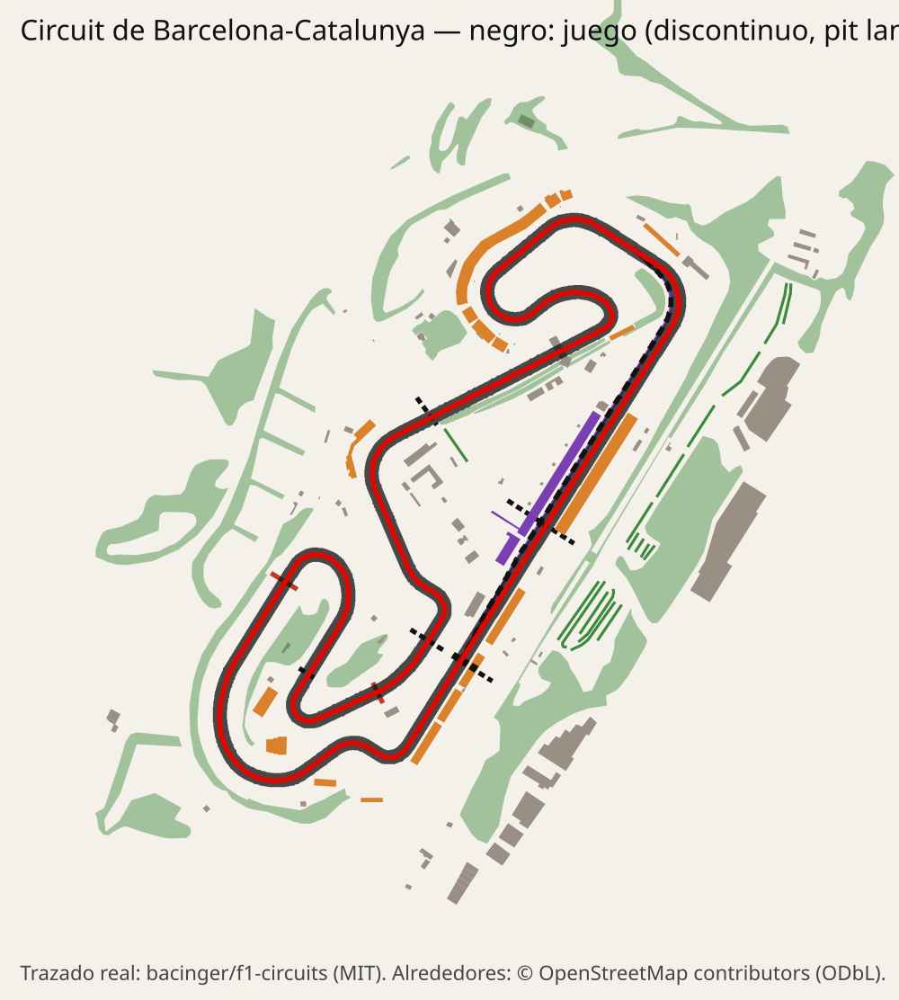

- **Trazado real:** GeoJSON de bacinger/f1-circuits (`es-1991`), 4664 m; en el juego, 4657 m. Encajado sobre el del juego, se aparta 0.7 m de media y 3.5 m como mucho; ningún tramo pasa de 15 m.
- **Pit lane:** comparado con el de OpenStreetMap, 0.5 m de media y 3 m como mucho.
- **Alrededores** (OpenStreetMap, franja de 300 m): árboles y bosque, 40 zonas o ejemplares (unos 321.000 m²); edificios, 89; agua, 0; túneles bajo la pista, 6; puentes sobre la pista, 2; gradas, 18 (Graderia principal, Tribuna B, Tribuna K, Tribuna E, Tribuna F); edificio de boxes, 2 (Boxes, Pit Lane Lounge); pit lane, 3 tramos.
- **Lo que no cuadra:**
  - **media** (CR6) — Túneles: 6 pasos bajo la pista en la realidad, 0 en el juego
  - **baja** (CR6) — Puentes: 2 cruzan la pista en la realidad, 1 en el juego
  - **baja** (CR6) — Edificios: 60 a menos de 150 m de la pista en la realidad, 1 en el juego

## `monza` — Autodromo Nazionale Monza

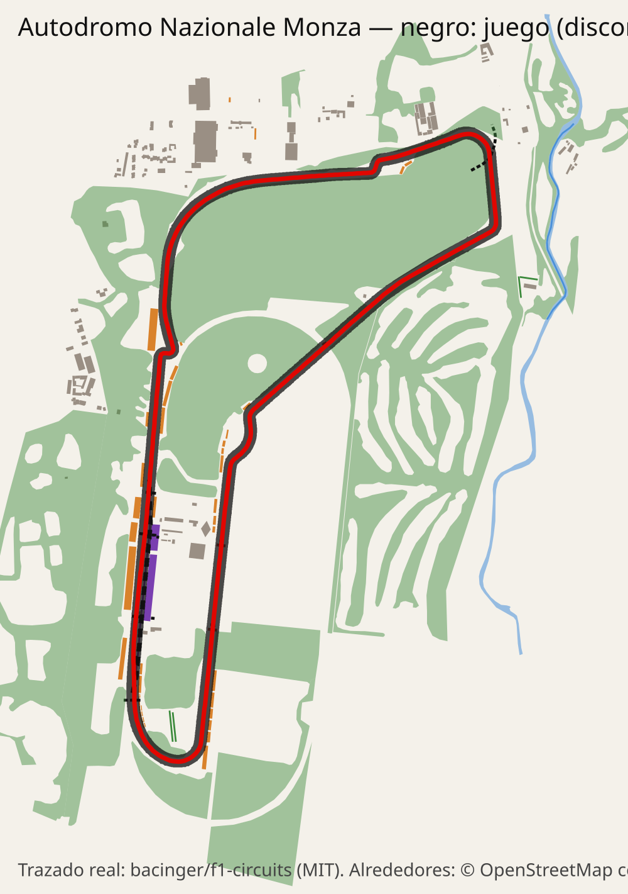

- **Trazado real:** GeoJSON de bacinger/f1-circuits (`it-1922`), 5787 m; en el juego, 5793 m. Encajado sobre el del juego, se aparta 1.4 m de media y 6.7 m como mucho; ningún tramo pasa de 15 m.
- **Pit lane:** comparado con el de OpenStreetMap, 1.6 m de media y 4.8 m como mucho.
- **Alrededores** (OpenStreetMap, franja de 300 m): árboles y bosque, 24 zonas o ejemplares (unos 2.114.000 m²); edificios, 118; agua, 4 (Lambro); túneles bajo la pista, 9; puentes sobre la pista, 4 (Autodromo nazionale di Monza - anello alta velocità); gradas, 43 (Tribuna Laterale Destra, Tribuna Parabolica, Tribuna Laterale Sinistra, Tribuna Centrale, Tribune); edificio de boxes, 2 (Palazzina Box, Hospitality Building); pit lane, 1 tramo.
- **Lo que no cuadra:**
  - **media** (CR6) — Túneles: 9 pasos bajo la pista en la realidad, 0 en el juego
  - **baja** (CR6) — Puentes: 4 cruzan la pista en la realidad, 2 en el juego
  - **baja** (CR6) — Edificios: 38 a menos de 150 m de la pista en la realidad, 1 en el juego

## `silverstone` — Silverstone Circuit

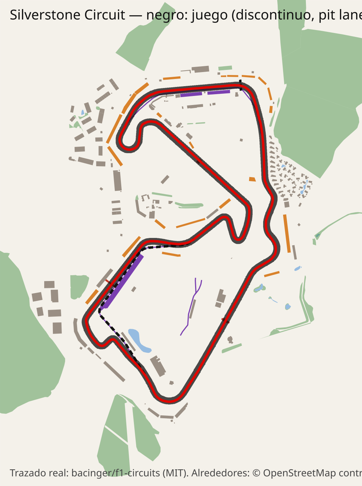

- **Trazado real:** GeoJSON de bacinger/f1-circuits (`gb-1948`), 5877 m; en el juego, 5891 m. Encajado sobre el del juego, se aparta 2 m de media y 8.8 m como mucho; ningún tramo pasa de 15 m.
- **Pit lane:** comparado con el de OpenStreetMap, 1.1 m de media y 5 m como mucho.
- **Alrededores** (OpenStreetMap, franja de 300 m): árboles y bosque, 34 zonas o ejemplares (unos 843.000 m²); edificios, 189; agua, 10; túneles bajo la pista, 2; puentes sobre la pista, 6; gradas, 22 (Copse A, Copse B, Copse C, Becketts, Village B); edificio de boxes, 3 (Silverstone Wing); pit lane, 5 tramos.
- **Lo que no cuadra:**
  - **media** (CR6) — Escenario: 4 objetos del juego caen donde en la realidad hay agua
  - **media** (CR6) — Puentes: 6 cruzan la pista en la realidad, 1 en el juego
  - **baja** (CR6) — Túneles: 2 pasos bajo la pista en la realidad, 0 en el juego
  - **baja** (CR6) — Edificios: 124 a menos de 150 m de la pista en la realidad, 1 en el juego

## `spa` — Circuit de Spa-Francorchamps

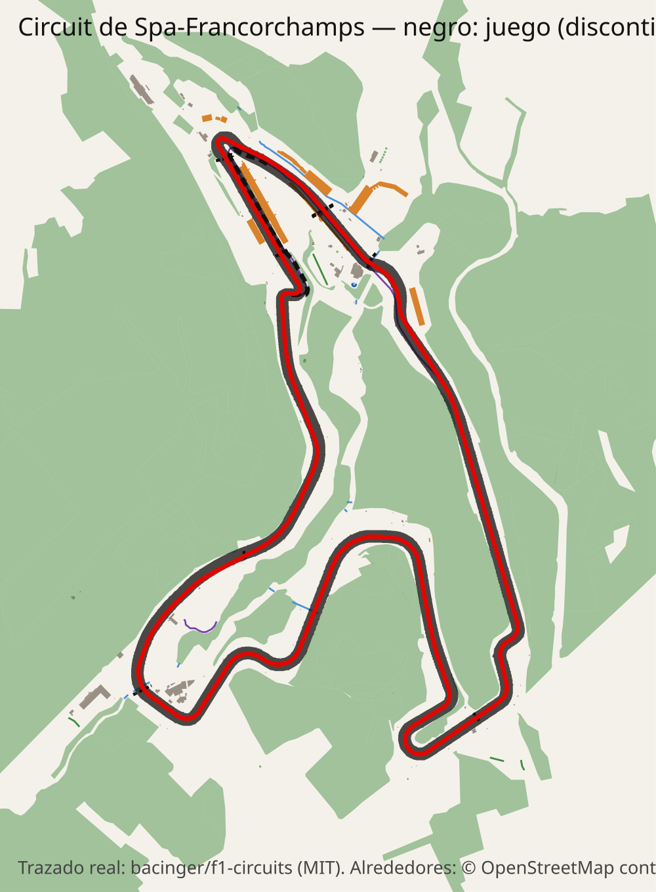

- **Trazado real:** GeoJSON de bacinger/f1-circuits (`be-1925`), 6978 m; en el juego, 7004 m. Encajado sobre el del juego, se aparta 3.7 m de media y 13.7 m como mucho; ningún tramo pasa de 15 m.
- **Pit lane:** comparado con el de OpenStreetMap, 1.5 m de media y 9.3 m como mucho.
- **Alrededores** (OpenStreetMap, franja de 300 m): árboles y bosque, 53 zonas o ejemplares (unos 5.382.000 m²); edificios, 149; agua, 14 (l'Eau Rouge, Le Rohon); túneles bajo la pista, 9 (Tunnel de Blanchimont, Tunnel de Ster, Tunnel Raidillon, Tunnel); puentes sobre la pista, 1; gradas, 10 (Stand F1, Stand Endurance, Tribune F1, Tribune RX, Tribune Raidillon); edificio de boxes, 0; pit lane, 3 tramos.
- **Lo que no cuadra:**
  - **media** (CR6) — Túneles: 9 pasos bajo la pista en la realidad (Tunnel de Blanchimont, Tunnel de Ster, Tunnel Raidillon), 0 en el juego
  - **baja** (CR6) — Edificios: 131 a menos de 150 m de la pista en la realidad, 1 en el juego

## `monaco` — Circuit de Monaco

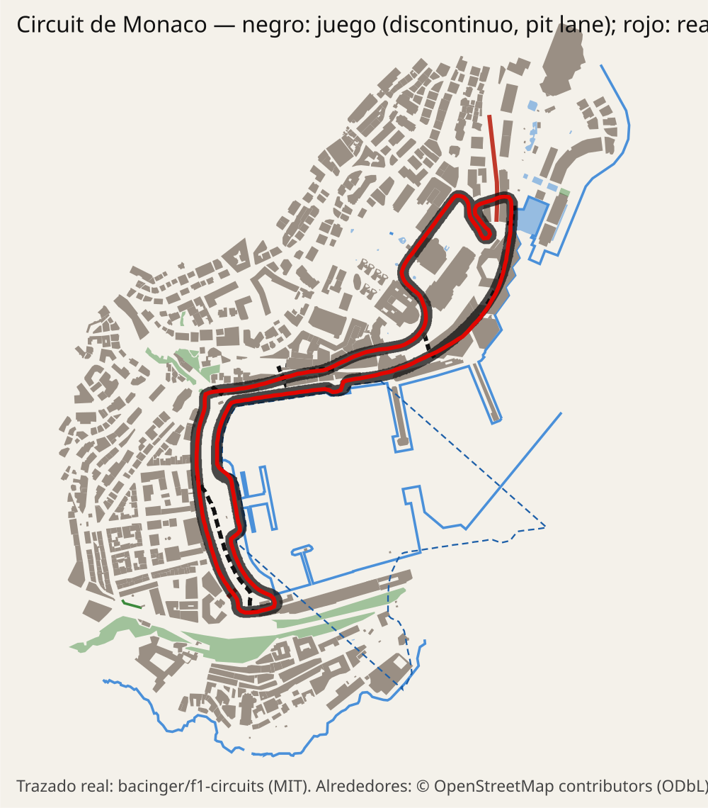

- **Trazado real:** GeoJSON de bacinger/f1-circuits (`mc-1929`), 3324 m; en el juego, 3337 m. Encajado sobre el del juego, se aparta 1.9 m de media y 10.6 m como mucho; ningún tramo pasa de 15 m.
- **Pit lane:** OpenStreetMap no marca el pit lane de este circuito (highway=raceway con service=pit_lane); queda para revisarlo a mano en CR2.
- **Alrededores** (OpenStreetMap, franja de 300 m): árboles y bosque, 11 zonas o ejemplares (unos 30.000 m²); edificios, 660; agua, 25 (Fontaine du Casino, Port du Petit Portier); túneles bajo la pista, 9 (Boulevard Louis II, Boulevard du Larvotto, Galerie du parking de la Costa, Circuit de Monaco); puentes sobre la pista, 2 (Boulevard du Larvotto); gradas, 0; edificio de boxes, 0; pit lane, 0 tramos.
- **Lo que no cuadra:**
  - **media** (CR6) — Agua: el juego pinta unos 217000 m² de agua donde en la realidad no hay
  - **media** (CR6) — Escenario: 7 objetos del juego caen donde en la realidad hay agua
  - **media** (CR6) — Túneles: 9 pasos bajo la pista en la realidad (Boulevard Louis II, Boulevard du Larvotto, Galerie du parking de la Costa), 1 en el juego
  - **baja** (CR6) — Escenario: 30 barcos del juego no están sobre el agua real

## `spielberg` — Red Bull Ring

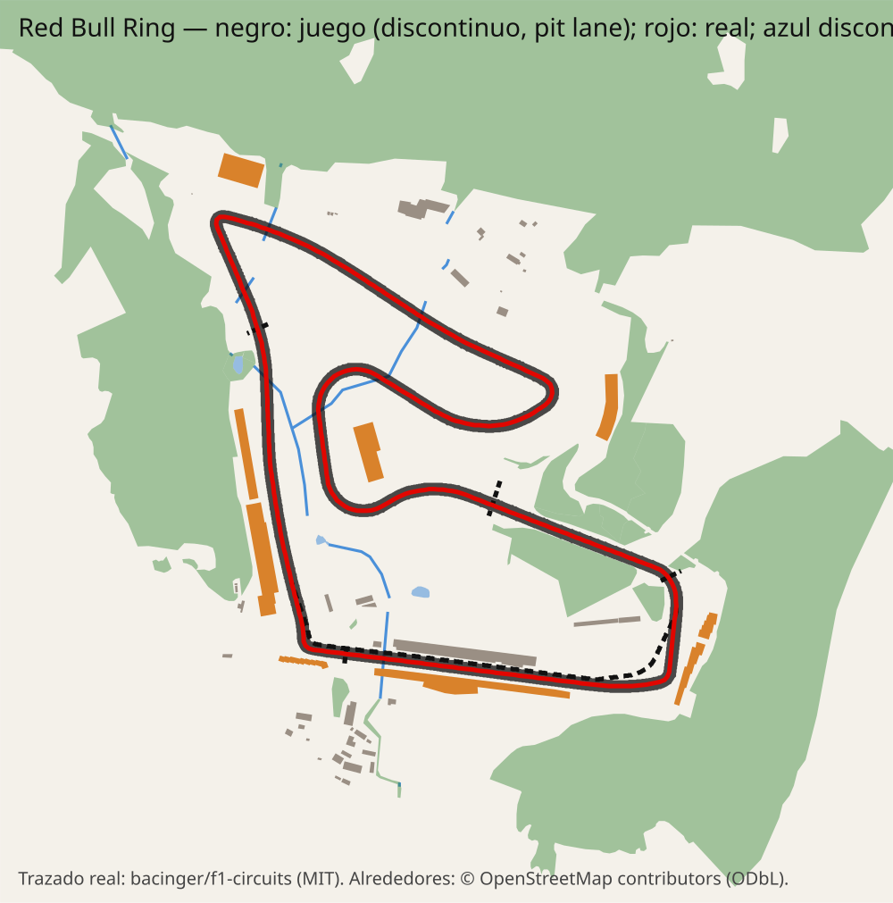

- **Trazado real:** GeoJSON de bacinger/f1-circuits (`at-1969`), 4302 m; en el juego, 4318 m. Encajado sobre el del juego, se aparta 0.8 m de media y 2.6 m como mucho; ningún tramo pasa de 15 m.
- **Pit lane:** OpenStreetMap no marca el pit lane de este circuito (highway=raceway con service=pit_lane); queda para revisarlo a mano en CR2.
- **Alrededores** (OpenStreetMap, franja de 300 m): árboles y bosque, 20 zonas o ejemplares (unos 1.713.000 m²); edificios, 45; agua, 15 (Spielbergbach, Schönbergbach); túneles bajo la pista, 4 (Red-Bull-Ring-Straße); puentes sobre la pista, 0; gradas, 9 (Red Bull Tribüne, Steiermark Tribüne, Start/Ziel Tribüne, Tribüne Nord, Tribüne Ost); edificio de boxes, 0; pit lane, 0 tramos.
- **Lo que no cuadra:**
  - **media** (CR6) — Túneles: 4 pasos bajo la pista en la realidad (Red-Bull-Ring-Straße), 0 en el juego
  - **baja** (CR6) — Edificios: 20 a menos de 150 m de la pista en la realidad, 1 en el juego

## `interlagos` — Autódromo José Carlos Pace - Interlagos

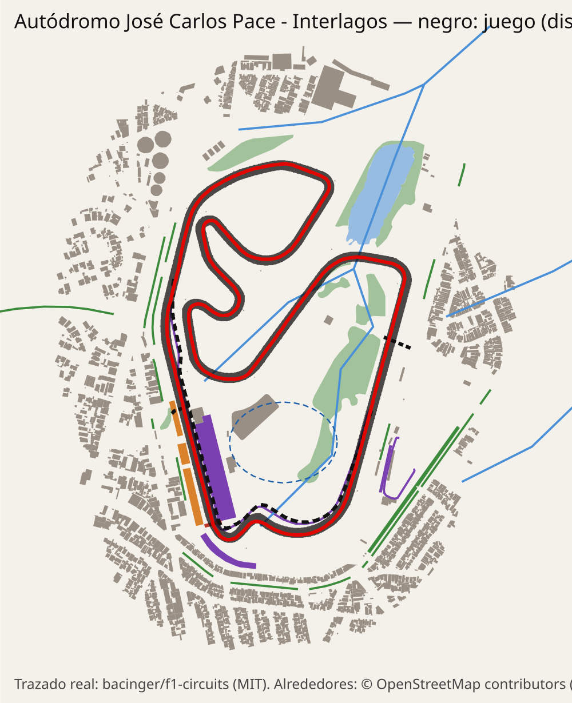

- **Trazado real:** GeoJSON de bacinger/f1-circuits (`br-1940`), 4298 m; en el juego, 4309 m. Encajado sobre el del juego, se aparta 2.6 m de media y 9.5 m como mucho; ningún tramo pasa de 15 m.
- **Pit lane:** comparado con el de OpenStreetMap, 4.8 m de media y 8.2 m como mucho.
- **Alrededores** (OpenStreetMap, franja de 300 m): árboles y bosque, 29 zonas o ejemplares (unos 66.000 m²); edificios, 1665; agua, 6; túneles bajo la pista, 2; puentes sobre la pista, 1; gradas, 3 (M); edificio de boxes, 1; pit lane, 2 tramos.
- **Lo que no cuadra:**
  - **media** (CR6) — Agua: hay unos 28000 m² de agua a menos de 300 m de la pista y el juego pinta el 0 %
  - **media** (CR6) — Agua: el juego pinta unos 53000 m² de agua donde en la realidad no hay
  - **media** (CR6) — Escenario: 9 objetos del juego caen donde en la realidad hay agua
  - **baja** (CR6) — Túneles: 2 pasos bajo la pista en la realidad, 0 en el juego
  - **baja** (CR6) — Edificios: 313 a menos de 150 m de la pista en la realidad, 9 en el juego

## `suzuka` — Suzuka International Racing Course

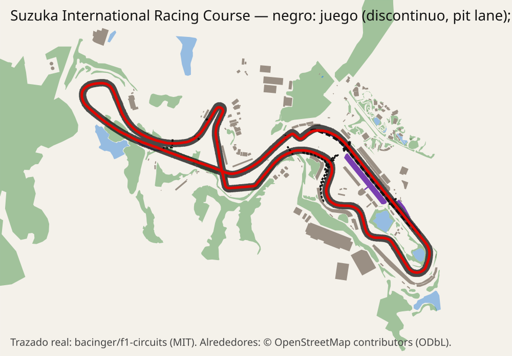

- **Trazado real:** GeoJSON de bacinger/f1-circuits (`jp-1962`), 5812 m; en el juego, 5807 m. Encajado sobre el del juego, se aparta 2.3 m de media y 13.3 m como mucho; ningún tramo pasa de 15 m.
- **Pit lane:** comparado con el de OpenStreetMap, 1.4 m de media y 7.3 m como mucho.
- **Alrededores** (OpenStreetMap, franja de 300 m): árboles y bosque, 113 zonas o ejemplares (unos 856.000 m²); edificios, 172; agua, 10 (丸竹池, アドベンボート フロンティア); túneles bajo la pista, 12 (三行庄野線); puentes sobre la pista, 1; gradas, 0; edificio de boxes, 1 (ピットビル); pit lane, 2 tramos.
- **Lo que no cuadra:**
  - **media** (CR6) — Agua: hay unos 41000 m² de agua a menos de 300 m de la pista y el juego pinta el 0 %
  - **media** (CR6) — Escenario: 10 objetos del juego caen donde en la realidad hay agua
  - **media** (CR6) — Túneles: 12 pasos bajo la pista en la realidad (三行庄野線), 0 en el juego
  - **baja** (CR6) — Edificios: 124 a menos de 150 m de la pista en la realidad, 1 en el juego

## `zandvoort` — Circuit Zandvoort

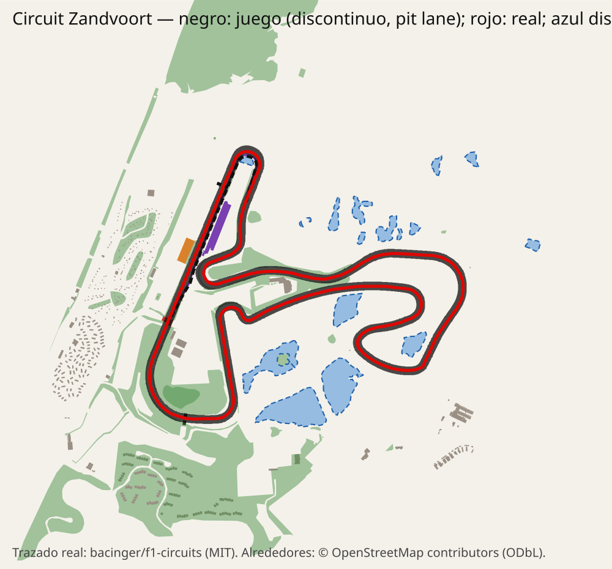

- **Trazado real:** GeoJSON de bacinger/f1-circuits (`nl-1948`), 4255 m; en el juego, 4259 m. Encajado sobre el del juego, se aparta 1.4 m de media y 12.2 m como mucho; ningún tramo pasa de 15 m.
- **Pit lane:** comparado con el de OpenStreetMap, 2 m de media y 4.7 m como mucho.
- **Alrededores** (OpenStreetMap, franja de 300 m): árboles y bosque, 54 zonas o ejemplares (unos 391.000 m²); edificios, 530; agua, 17; túneles bajo la pista, 3; puentes sobre la pista, 1; gradas, 1 (Hoofdtribune); edificio de boxes, 1 (Pitgebouw); pit lane, 1 tramo.
- **Lo que no cuadra:**
  - **media** (CR6) — Agua: hay unos 58000 m² de agua a menos de 300 m de la pista y el juego pinta el 37 %
  - **media** (CR6) — Agua: el juego pinta unos 205000 m² de agua donde en la realidad no hay
  - **media** (CR6) — Escenario: 12 objetos del juego caen donde en la realidad hay agua
  - **baja** (CR6) — Túneles: 3 pasos bajo la pista en la realidad, 0 en el juego
  - **baja** (CR6) — Edificios: 63 a menos de 150 m de la pista en la realidad, 0 en el juego

## `las-vegas` — Las Vegas Street Circuit

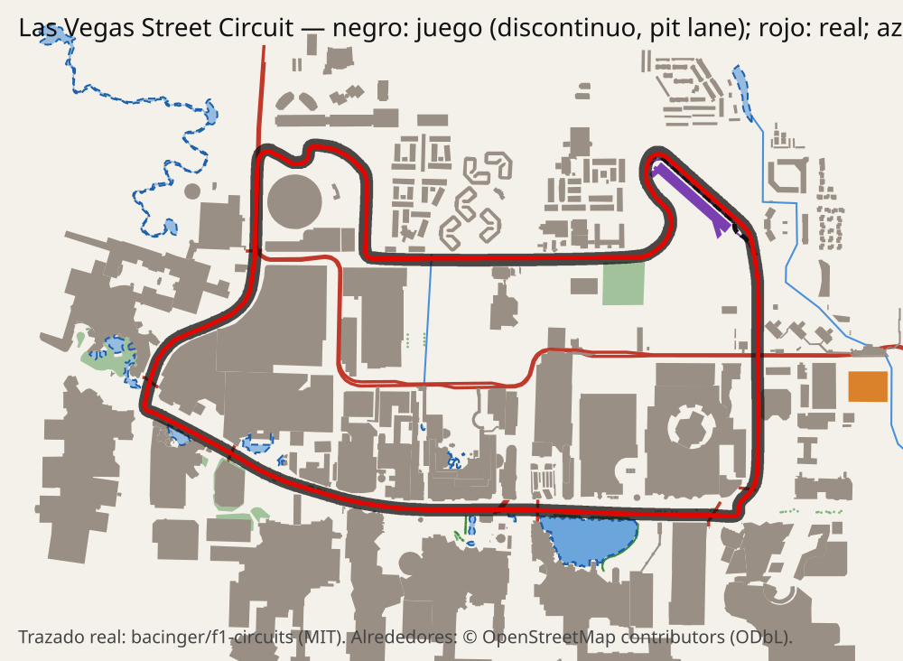

- **Trazado real:** GeoJSON de bacinger/f1-circuits (`us-2023`), 6221 m; en el juego, 6201 m. Encajado sobre el del juego, se aparta 1.8 m de media y 7.8 m como mucho; ningún tramo pasa de 15 m.
- **Pit lane:** comparado con el de OpenStreetMap, 3.9 m de media y 14.7 m como mucho.
- **Alrededores** (OpenStreetMap, franja de 300 m): árboles y bosque, 25 zonas o ejemplares (unos 34.000 m²); edificios, 377; agua, 22 (Fountains of Bellagio, Lake of Dreams, Flamingo Wash, Tropicana Wash); túneles bajo la pista, 0; puentes sobre la pista, 10 (Las Vegas Boulevard Overpass, Las Vegas Monorail, CityCenter Pedestrian Bridge); gradas, 1 (MGM Grand Garden Arena); edificio de boxes, 1 (Grand Prix Plaza); pit lane, 1 tramo.
- **Lo que no cuadra:**
  - **media** (CR6) — Agua: hay unos 53000 m² de agua a menos de 300 m de la pista y el juego pinta el 0 %
  - **media** (CR6) — Escenario: 9 objetos del juego caen donde en la realidad hay agua
  - **media** (CR6) — Puentes: 10 cruzan la pista en la realidad, 1 en el juego
  - **media** (CR6) — Edificios: 204 a menos de 150 m de la pista en la realidad, 26 en el juego

## `bahrain` — Bahrain International Circuit

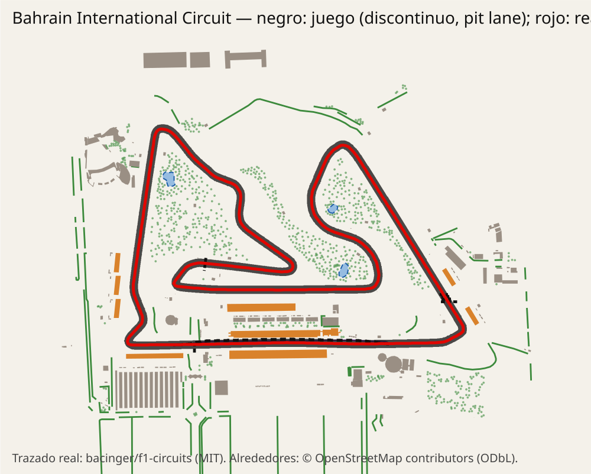

- **Trazado real:** GeoJSON de bacinger/f1-circuits (`bh-2002`), 5418 m; en el juego, 5412 m. Encajado sobre el del juego, se aparta 0.8 m de media y 6.3 m como mucho; ningún tramo pasa de 15 m.
- **Pit lane:** comparado con el de OpenStreetMap, 2.9 m de media y 7.1 m como mucho.
- **Alrededores** (OpenStreetMap, franja de 300 m): árboles y bosque, 70 zonas o ejemplares (unos 0 m²); edificios, 195; agua, 3; túneles bajo la pista, 6 (Drag Strip); puentes sobre la pista, 0; gradas, 9 (Batelco, Main Grandstand, University Grandstand 2, University Grandstand 3, Victory Grandstand 1); edificio de boxes, 0; pit lane, 1 tramo.
- **Lo que no cuadra:**
  - **media** (CR6) — Escenario: 1 objeto del juego cae donde en la realidad hay agua
  - **media** (CR6) — Túneles: 6 pasos bajo la pista en la realidad (Drag Strip), 0 en el juego
  - **baja** (CR6) — Edificios: 144 a menos de 150 m de la pista en la realidad, 1 en el juego

## `baku` — Baku City Circuit

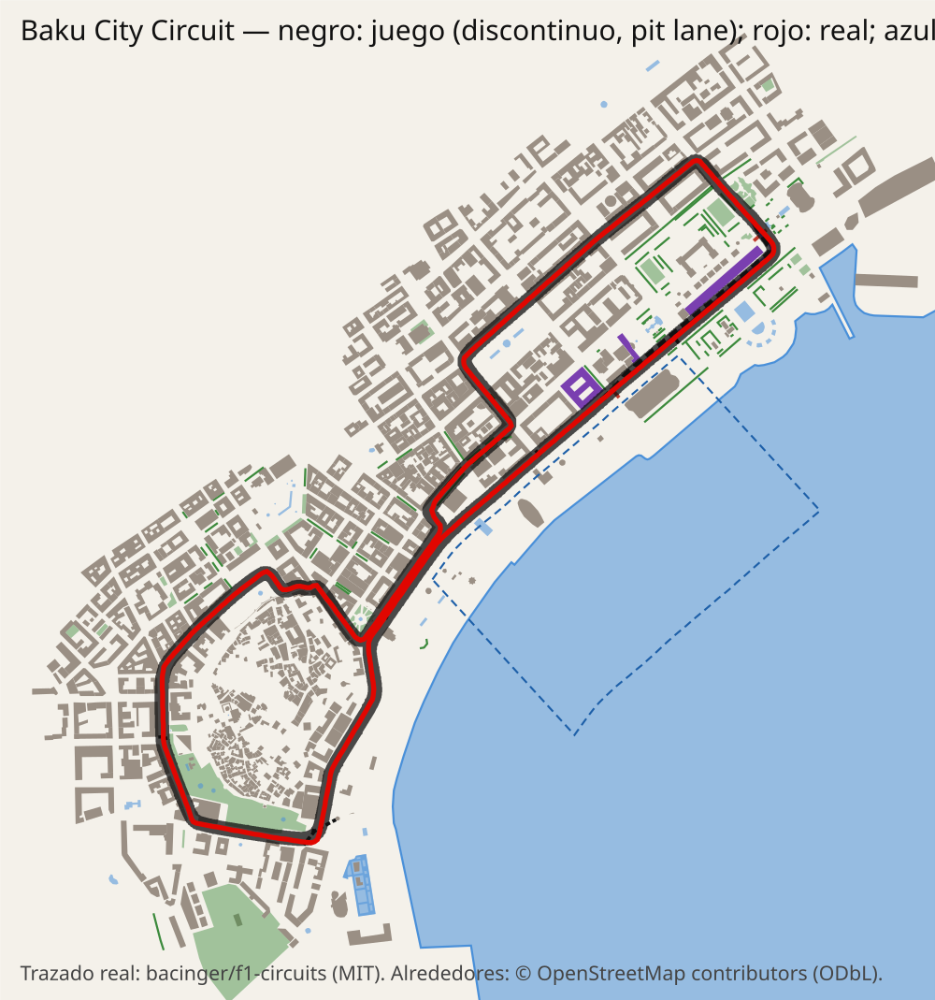

- **Trazado real:** GeoJSON de bacinger/f1-circuits (`az-2016`), 5986 m; en el juego, 6003 m. Encajado sobre el del juego, se aparta 1.9 m de media y 11.8 m como mucho; ningún tramo pasa de 15 m.
- **Pit lane:** comparado con el de OpenStreetMap, 3.8 m de media y 8.3 m como mucho.
- **Alrededores** (OpenStreetMap, franja de 300 m): árboles y bosque, 129 zonas o ejemplares (unos 104.000 m²); edificios, 918; agua, 46 (Kiçik Venesiya, Каспий теңізі - Hazar deňzi - دریای خزر - Xəzər dənizi - Каспийское море - دریای مازندران, mar (línea de costa)); túneles bajo la pista, 7; puentes sobre la pista, 2; gradas, 0; edificio de boxes, 3 (Hilton, Baku City Circuit, Sərhəd Qoşunları Xidməti); pit lane, 1 tramo.
- **Lo que no cuadra:**
  - **media** (CR6) — Agua: hay unos 257000 m² de agua a menos de 300 m de la pista y el juego pinta el 40 %
  - **media** (CR6) — Agua: el juego pinta unos 140000 m² de agua donde en la realidad no hay
  - **media** (CR6) — Escenario: 3 objetos del juego caen donde en la realidad hay agua
  - **media** (CR6) — Túneles: 7 pasos bajo la pista en la realidad, 0 en el juego
  - **media** (CR6) — Edificios: 574 a menos de 150 m de la pista en la realidad, 18 en el juego
  - **baja** (CR6) — Puentes: 2 cruzan la pista en la realidad, 1 en el juego

## `melbourne` — Albert Park Circuit

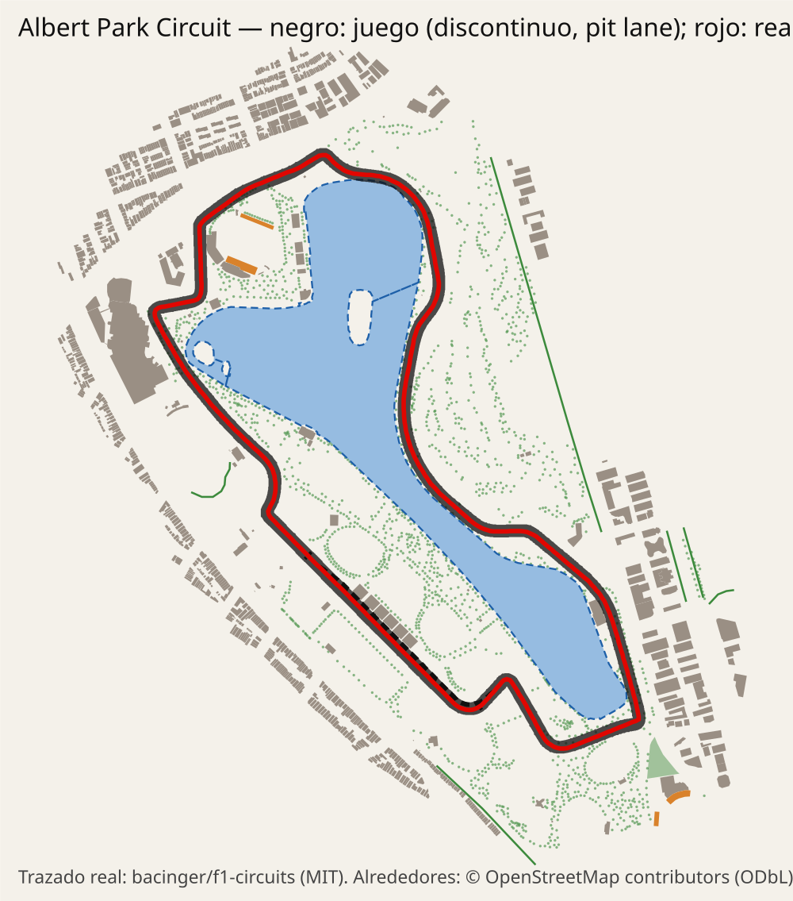

- **Trazado real:** GeoJSON de bacinger/f1-circuits (`au-1953`), 5273 m; en el juego, 5278 m. Encajado sobre el del juego, se aparta 1.3 m de media y 8.4 m como mucho; ningún tramo pasa de 15 m.
- **Pit lane:** OpenStreetMap no marca el pit lane de este circuito (highway=raceway con service=pit_lane); queda para revisarlo a mano en CR2.
- **Alrededores** (OpenStreetMap, franja de 300 m): árboles y bosque, 7 zonas o ejemplares (unos 6000 m²); edificios, 984; agua, 1 (Albert Park Lake); túneles bajo la pista, 2; puentes sobre la pista, 0; gradas, 4 (Blackie Ironmonger Stand); edificio de boxes, 0; pit lane, 0 tramos.
- **Lo que no cuadra:**
  - **media** (CR6) — Agua: hay unos 461000 m² de agua a menos de 300 m de la pista y el juego pinta el 14 %
  - **media** (CR6) — Agua: el juego pinta unos 50000 m² de agua donde en la realidad no hay
  - **media** (CR6) — Escenario: 41 objetos del juego caen donde en la realidad hay agua
  - **media** (CR6) — Edificios: 125 a menos de 150 m de la pista en la realidad, 24 en el juego
  - **baja** (CR6) — Túneles: 2 pasos bajo la pista en la realidad, 0 en el juego

## `miami` — Miami International Autodrome

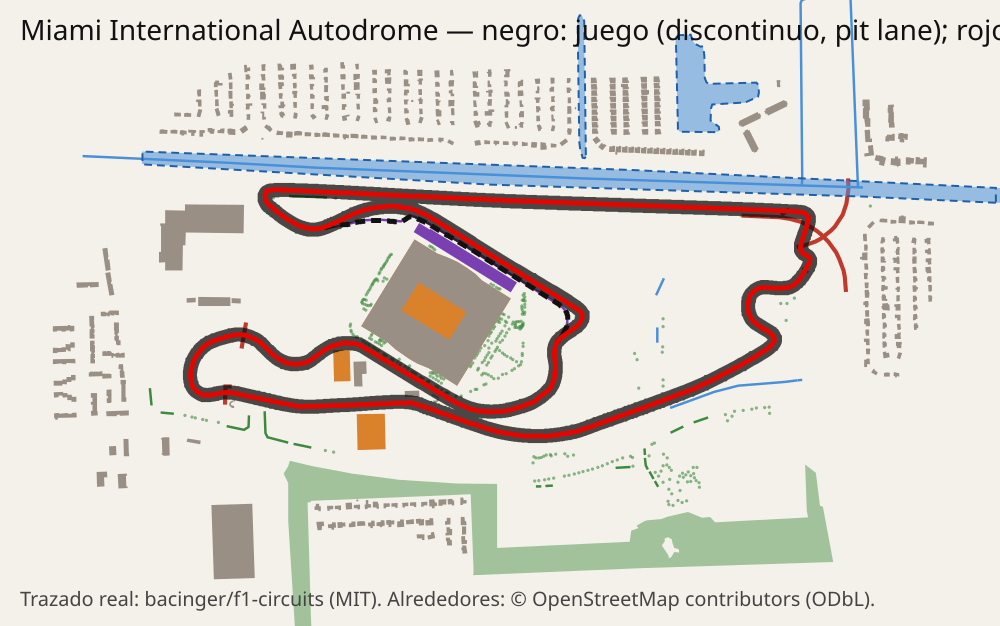

- **Trazado real:** GeoJSON de bacinger/f1-circuits (`us-2022`), 5415 m; en el juego, 5412 m. Encajado sobre el del juego, se aparta 0.9 m de media y 3.8 m como mucho; ningún tramo pasa de 15 m.
- **Pit lane:** comparado con el de OpenStreetMap, 1.1 m de media y 4.3 m como mucho.
- **Alrededores** (OpenStreetMap, franja de 300 m): árboles y bosque, 16 zonas o ejemplares (unos 135.000 m²); edificios, 402; agua, 11 (Snake Creek Canal); túneles bajo la pista, 0; puentes sobre la pista, 5; gradas, 3 (Hard Rock Stadium, Grandstand Stadium, Butch Buchholz); edificio de boxes, 1 (Paddock/Garage); pit lane, 1 tramo.
- **Lo que no cuadra:**
  - **media** (CR6) — Agua: hay unos 95000 m² de agua a menos de 300 m de la pista y el juego pinta el 0 %
  - **media** (CR6) — Agua: el juego pinta unos 28000 m² de agua donde en la realidad no hay
  - **media** (CR6) — Escenario: 2 objetos del juego caen donde en la realidad hay agua
  - **media** (CR6) — Puentes: 5 cruzan la pista en la realidad, 1 en el juego
  - **media** (CR6) — Árboles: unos 135000 m² de bosque o arbolado junto a la pista y 12 árboles en el juego
  - **baja** (CR6) — Escenario: 8 barcos del juego no están sobre el agua real

## `shanghai` — Shanghai International Circuit

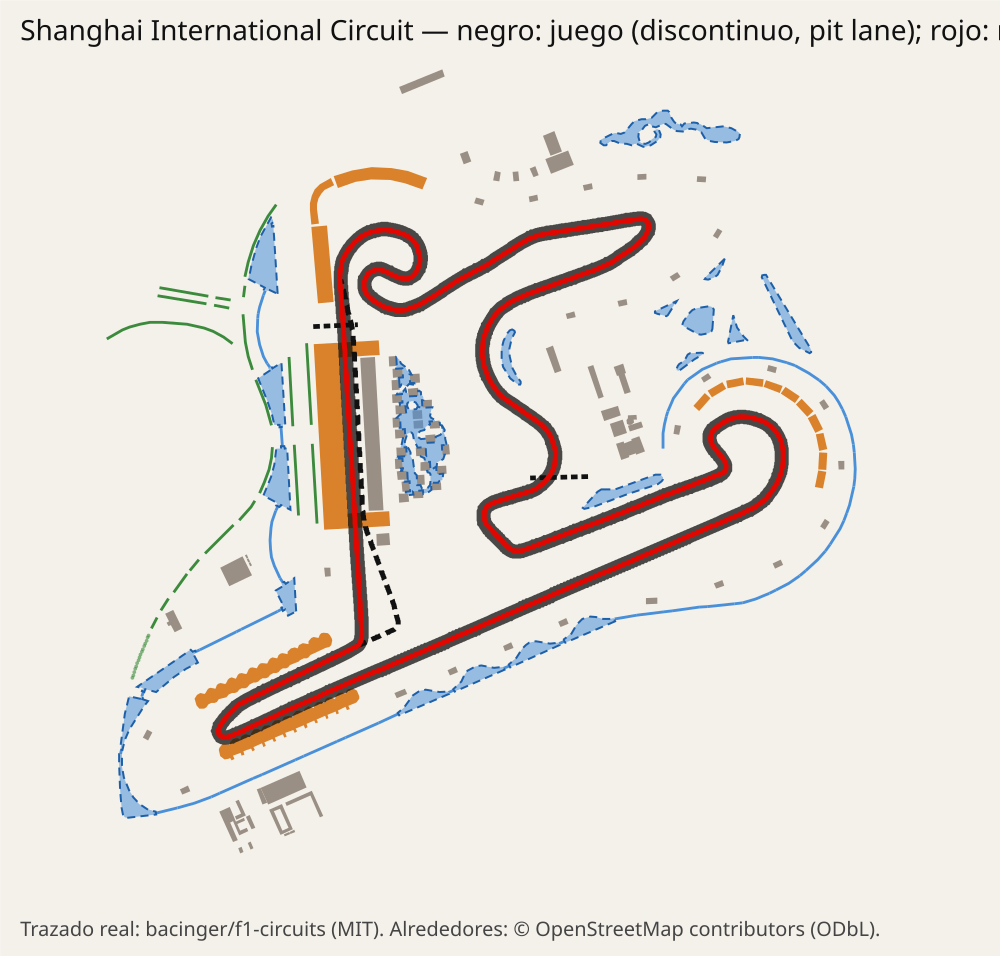

- **Trazado real:** GeoJSON de bacinger/f1-circuits (`cn-2004`), 5448 m; en el juego, 5451 m. Encajado sobre el del juego, se aparta 0.8 m de media y 3.1 m como mucho; ningún tramo pasa de 15 m.
- **Pit lane:** OpenStreetMap no marca el pit lane de este circuito (highway=raceway con service=pit_lane); queda para revisarlo a mano en CR2.
- **Alrededores** (OpenStreetMap, franja de 300 m): árboles y bosque, 20 zonas o ejemplares (unos 0 m²); edificios, 84; agua, 86; túneles bajo la pista, 2; puentes sobre la pista, 0; gradas, 17 (A看台, B1看台, B2看台, B3看台, H看台); edificio de boxes, 0; pit lane, 0 tramos.
- **Lo que no cuadra:**
  - **alta** (CR5) — Edificios emblemáticos: tribuna principal con sus dos alas y edificios de los equipos sobre el agua
  - **media** (CR6) — Agua: hay unos 65000 m² de agua a menos de 300 m de la pista y el juego pinta el 9 %
  - **media** (CR6) — Escenario: 16 objetos del juego caen donde en la realidad hay agua
  - **baja** (CR6) — Túneles: 2 pasos bajo la pista en la realidad, 0 en el juego
  - **baja** (CR6) — Árboles: el juego pone 220 y en la realidad casi no hay arbolado junto a la pista

## `jeddah` — Jeddah Corniche Circuit

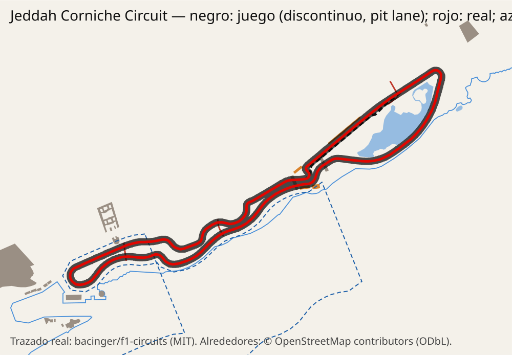

- **Trazado real:** GeoJSON de bacinger/f1-circuits (`sa-2021`), 6196 m; en el juego, 6174 m. Encajado sobre el del juego, se aparta 1.4 m de media y 4.6 m como mucho; ningún tramo pasa de 15 m.
- **Pit lane:** OpenStreetMap no marca el pit lane de este circuito (highway=raceway con service=pit_lane); queda para revisarlo a mano en CR2.
- **Alrededores** (OpenStreetMap, franja de 300 m): árboles y bosque, 0 zonas o ejemplares (unos 0 m²); edificios, 20; agua, 4 (mar (línea de costa)); túneles bajo la pista, 1; puentes sobre la pista, 3; gradas, 4; edificio de boxes, 0; pit lane, 0 tramos.
- **Lo que no cuadra:**
  - **media** (CR6) — Agua: hay unos 839000 m² de agua a menos de 300 m de la pista y el juego pinta el 35 %
  - **media** (CR6) — Agua: el juego pinta unos 137000 m² de agua donde en la realidad no hay
  - **media** (CR6) — Escenario: 2 objetos del juego caen donde en la realidad hay agua
  - **baja** (CR6) — Túneles: 1 pasos bajo la pista en la realidad, 0 en el juego
  - **baja** (CR6) — Puentes: 3 cruzan la pista en la realidad, 1 en el juego

## `marina-bay` — Marina Bay Street Circuit

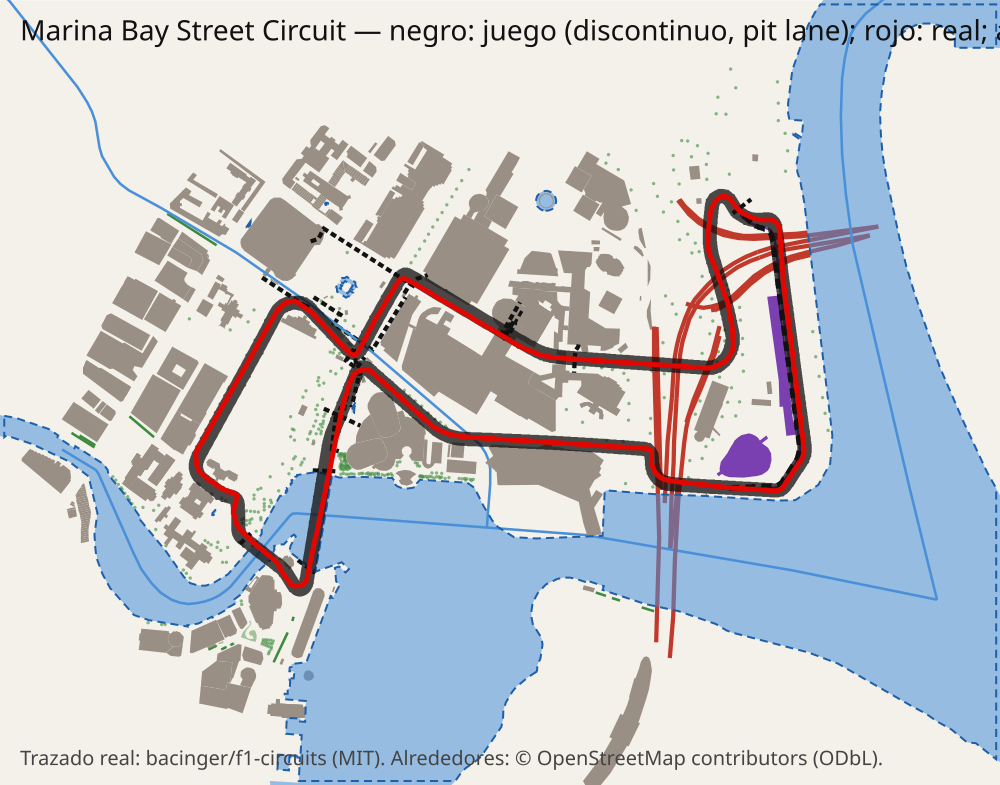

- **Trazado real:** GeoJSON de bacinger/f1-circuits (`sg-2008`), 4943 m; en el juego, 4940 m. Encajado sobre el del juego, se aparta 3.8 m de media y 12.5 m como mucho; ningún tramo pasa de 15 m.
- **Pit lane:** comparado con el de OpenStreetMap, 2.8 m de media y 5.3 m como mucho.
- **Alrededores** (OpenStreetMap, franja de 300 m): árboles y bosque, 18 zonas o ejemplares (unos 2000 m²); edificios, 236; agua, 15 (Fountain of Wealth, Marina Reservoir, Kallang Basin, Singapore River, Stamford Canal); túneles bajo la pista, 23 (The Esplanade, North Boat Quay, CityLink Mall, Esplanade Xchange, Fullerton Promenade); puentes sobre la pista, 15 (East Coast Parkway); gradas, 0; edificio de boxes, 3 (F1 Pit Building, Singapore Flyer); pit lane, 1 tramo.
- **Lo que no cuadra:**
  - **media** (CR6) — Agua: hay unos 645000 m² de agua a menos de 300 m de la pista y el juego pinta el 6 %
  - **media** (CR6) — Agua: el juego pinta unos 164000 m² de agua donde en la realidad no hay
  - **media** (CR6) — Escenario: 1 objeto del juego cae donde en la realidad hay agua
  - **media** (CR6) — Túneles: 23 pasos bajo la pista en la realidad (The Esplanade, North Boat Quay, CityLink Mall), 0 en el juego
  - **media** (CR6) — Puentes: 15 cruzan la pista en la realidad, 1 en el juego

## `lusail` — Losail International Circuit

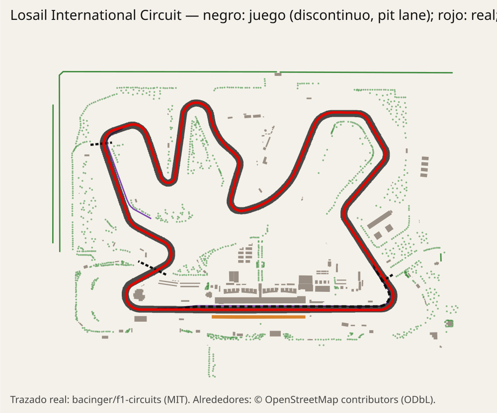

- **Trazado real:** GeoJSON de bacinger/f1-circuits (`qa-2004`), 5421 m; en el juego, 5419 m. Encajado sobre el del juego, se aparta 1.9 m de media y 7.2 m como mucho; ningún tramo pasa de 15 m.
- **Pit lane:** comparado con el de OpenStreetMap, 2.9 m de media y 7.9 m como mucho.
- **Alrededores** (OpenStreetMap, franja de 300 m): árboles y bosque, 4 zonas o ejemplares (unos 0 m²); edificios, 148; agua, 0; túneles bajo la pista, 3; puentes sobre la pista, 0; gradas, 1; edificio de boxes, 0; pit lane, 4 tramos.
- **Lo que no cuadra:**
  - **baja** (CR6) — Túneles: 3 pasos bajo la pista en la realidad, 0 en el juego
  - **baja** (CR6) — Edificios: 103 a menos de 150 m de la pista en la realidad, 0 en el juego

## `yas-marina` — Yas Marina Circuit

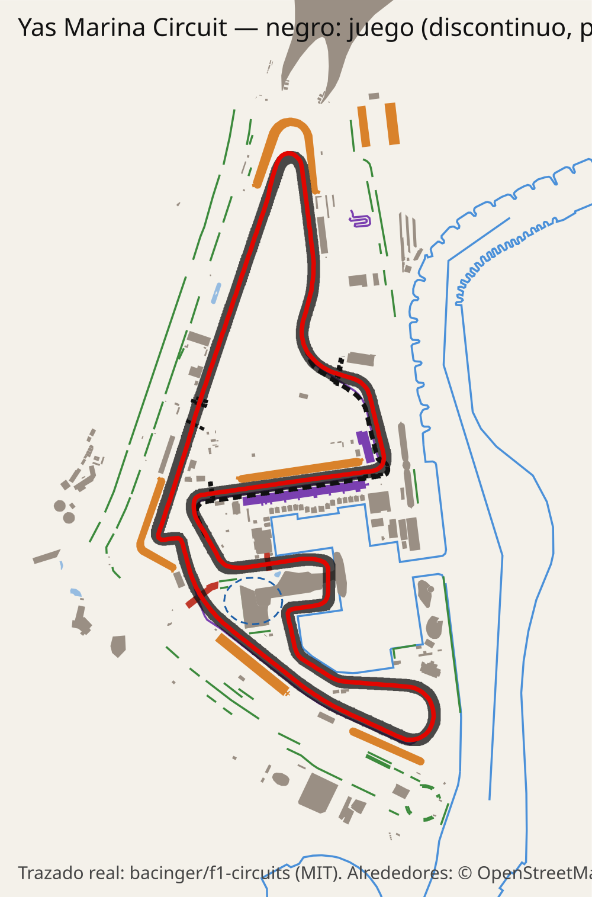

- **Trazado real:** GeoJSON de bacinger/f1-circuits (`ae-2009`), 5293 m; en el juego, 5281 m. Encajado sobre el del juego, se aparta 2.2 m de media y 14.5 m como mucho; ningún tramo pasa de 15 m.
- **Pit lane:** comparado con el de OpenStreetMap, 4.9 m de media y 8.5 m como mucho.
- **Alrededores** (OpenStreetMap, franja de 300 m): árboles y bosque, 59 zonas o ejemplares (unos 4000 m²); edificios, 179; agua, 14 (mar (línea de costa)); túneles bajo la pista, 9 (Pit Lane, Access to Main Grandstand); puentes sobre la pista, 5 (Marina Walk Bridge); gradas, 7 (Marina Grandstand, South Grandstand, West Grandstand, North Grandstand, Main Grandstand); edificio de boxes, 1; pit lane, 5 tramos.
- **Lo que no cuadra:**
  - **alta** (CR5) — Edificios emblemáticos: hotel con la cubierta de luces sobre la pista, puente sobre el pit lane y puerto deportivo
  - **media** (CR6) — Agua: hay unos 336000 m² de agua a menos de 300 m de la pista y el juego pinta el 0 %
  - **media** (CR6) — Escenario: 14 objetos del juego caen donde en la realidad hay agua
  - **media** (CR6) — Túneles: 9 pasos bajo la pista en la realidad (Pit Lane, Access to Main Grandstand), 1 en el juego
  - **media** (CR6) — Puentes: 5 cruzan la pista en la realidad, 2 en el juego
  - **baja** (CR6) — Escenario: 14 barcos del juego no están sobre el agua real
  - **baja** (CR6) — Edificios: 102 a menos de 150 m de la pista en la realidad, 1 en el juego

## `hungaroring` — Hungaroring

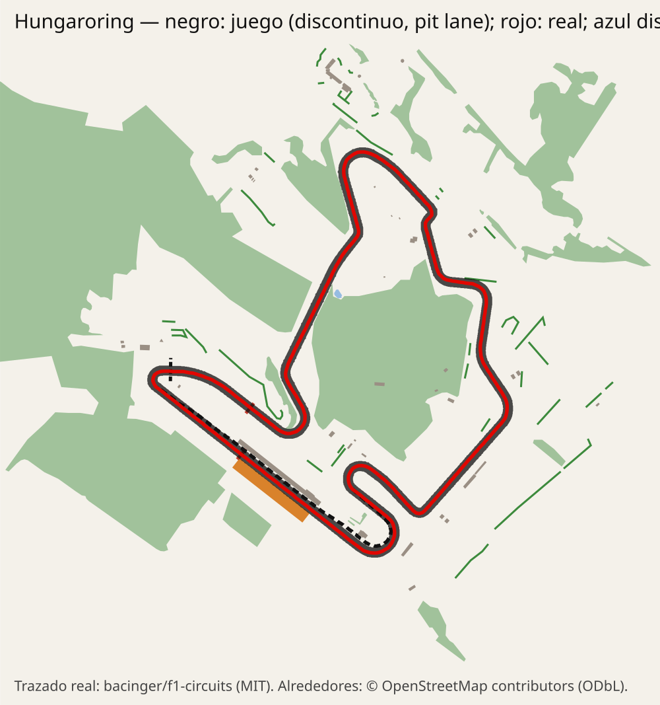

- **Trazado real:** GeoJSON de bacinger/f1-circuits (`hu-1986`), 4376 m; en el juego, 4381 m. Encajado sobre el del juego, se aparta 1.5 m de media y 4 m como mucho; ningún tramo pasa de 15 m.
- **Pit lane:** OpenStreetMap no marca el pit lane de este circuito (highway=raceway con service=pit_lane); queda para revisarlo a mano en CR2.
- **Alrededores** (OpenStreetMap, franja de 300 m): árboles y bosque, 55 zonas o ejemplares (unos 1.049.000 m²); edificios, 42; agua, 1; túneles bajo la pista, 1; puentes sobre la pista, 2; gradas, 1 (Hungaroring); edificio de boxes, 0; pit lane, 0 tramos.
- **Lo que no cuadra:**
  - **baja** (CR6) — Túneles: 1 pasos bajo la pista en la realidad, 0 en el juego
  - **baja** (CR6) — Puentes: 2 cruzan la pista en la realidad, 1 en el juego
  - **baja** (CR6) — Edificios: 28 a menos de 150 m de la pista en la realidad, 0 en el juego

## `mexico-city` — Autódromo Hermanos Rodríguez

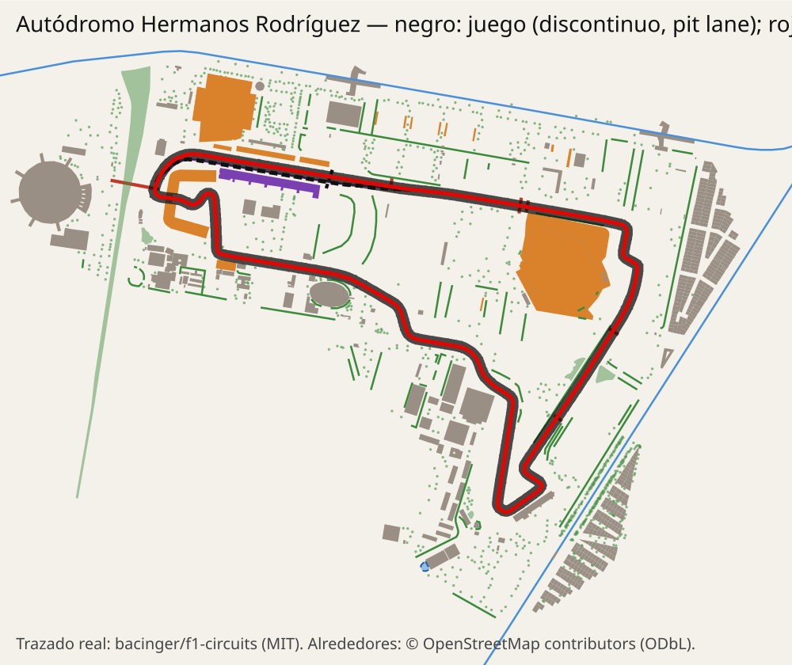

- **Trazado real:** GeoJSON de bacinger/f1-circuits (`mx-1962`), 4302 m; en el juego, 4304 m. Encajado sobre el del juego, se aparta 0.9 m de media y 3.2 m como mucho; ningún tramo pasa de 15 m.
- **Pit lane:** comparado con el de OpenStreetMap, 1 m de media y 4.1 m como mucho.
- **Alrededores** (OpenStreetMap, franja de 300 m): árboles y bosque, 74 zonas o ejemplares (unos 32.000 m²); edificios, 479; agua, 3 (Río de la Piedad, Río Churubusco); túneles bajo la pista, 1; puentes sobre la pista, 6 (Calle 63); gradas, 29 (Estadio Alfredo Harp Helú, Platea Alta Izquierda, Palco Central, Dugout Local, Dugout Visitante); edificio de boxes, 1 (Paddock); pit lane, 2 tramos.
- **Lo que no cuadra:**
  - **media** (CR6) — Puentes: 6 cruzan la pista en la realidad, 1 en el juego
  - **baja** (CR6) — Túneles: 1 pasos bajo la pista en la realidad, 0 en el juego
  - **baja** (CR6) — Edificios: 119 a menos de 150 m de la pista en la realidad, 0 en el juego

## `montreal` — Circuit Gilles-Villeneuve

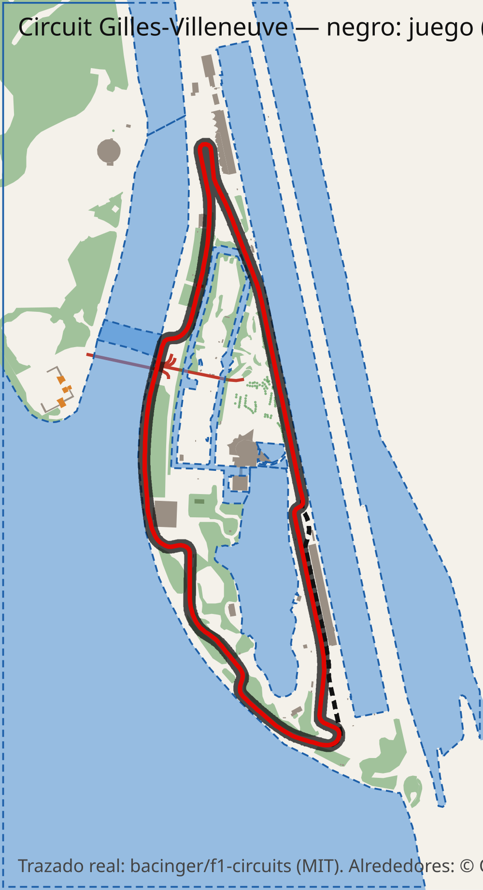

- **Trazado real:** GeoJSON de bacinger/f1-circuits (`ca-1978`), 4365 m; en el juego, 4361 m. Encajado sobre el del juego, se aparta 1 m de media y 4.3 m como mucho; ningún tramo pasa de 15 m.
- **Pit lane:** OpenStreetMap no marca el pit lane de este circuito (highway=raceway con service=pit_lane); queda para revisarlo a mano en CR2.
- **Alrededores** (OpenStreetMap, franja de 300 m): árboles y bosque, 36 zonas o ejemplares (unos 498.000 m²); edificios, 63; agua, 11 (Bassin olympique, Lac des régates); túneles bajo la pista, 0; puentes sobre la pista, 6 (Avenue Pierre-Dupuy, Pont des Iles); gradas, 5; edificio de boxes, 0; pit lane, 0 tramos.
- **Lo que no cuadra:**
  - **media** (CR6) — Agua: hay unos 1212000 m² de agua a menos de 300 m de la pista y el juego pinta el 6 %
  - **media** (CR6) — Escenario: 36 objetos del juego caen donde en la realidad hay agua
  - **media** (CR6) — Puentes: 6 cruzan la pista en la realidad, 1 en el juego
  - **media** (CR6) — Árboles: unos 498000 m² de bosque o arbolado junto a la pista y 12 árboles en el juego

## `austin` — Circuit of the Americas

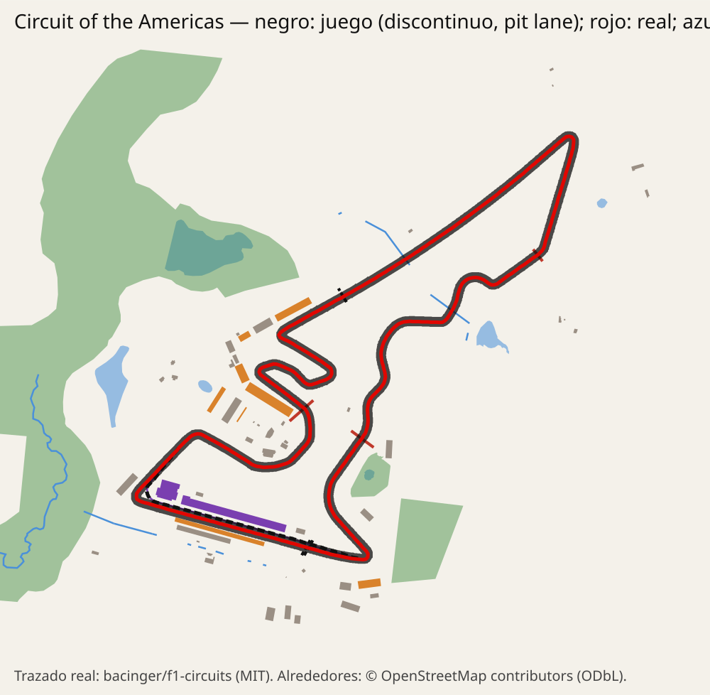

- **Trazado real:** GeoJSON de bacinger/f1-circuits (`us-2012`), 5520 m; en el juego, 5513 m. Encajado sobre el del juego, se aparta 0.7 m de media y 7 m como mucho; ningún tramo pasa de 15 m.
- **Pit lane:** comparado con el de OpenStreetMap, 0.9 m de media y 3.4 m como mucho.
- **Alrededores** (OpenStreetMap, franja de 300 m): árboles y bosque, 3 zonas o ejemplares (unos 769.000 m²); edificios, 45; agua, 19 (Jenkins and White Pond); túneles bajo la pista, 3; puentes sobre la pista, 3; gradas, 8 (Turn 15 Grandstands); edificio de boxes, 2 (Pit Garages); pit lane, 1 tramo.
- **Lo que no cuadra:**
  - **media** (CR6) — Escenario: 1 objeto del juego cae donde en la realidad hay agua
  - **baja** (CR6) — Túneles: 3 pasos bajo la pista en la realidad, 0 en el juego
  - **baja** (CR6) — Puentes: 3 cruzan la pista en la realidad, 1 en el juego
  - **baja** (CR6) — Edificios: 31 a menos de 150 m de la pista en la realidad, 1 en el juego
